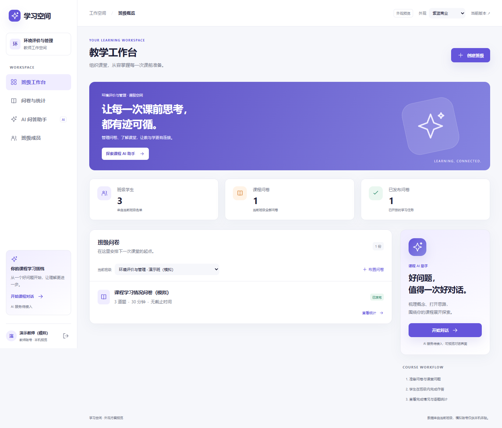
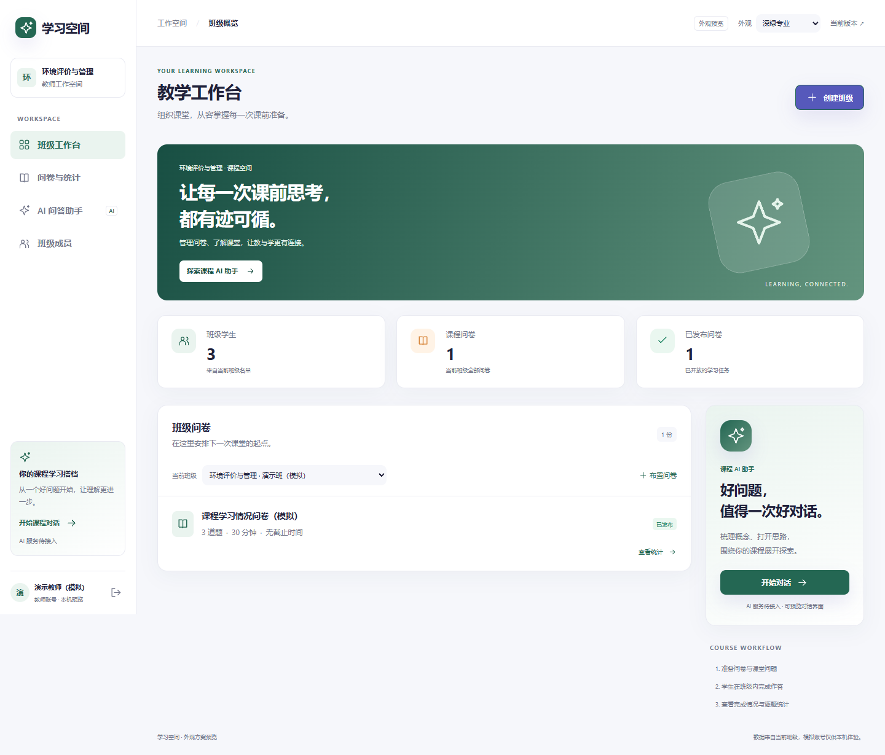
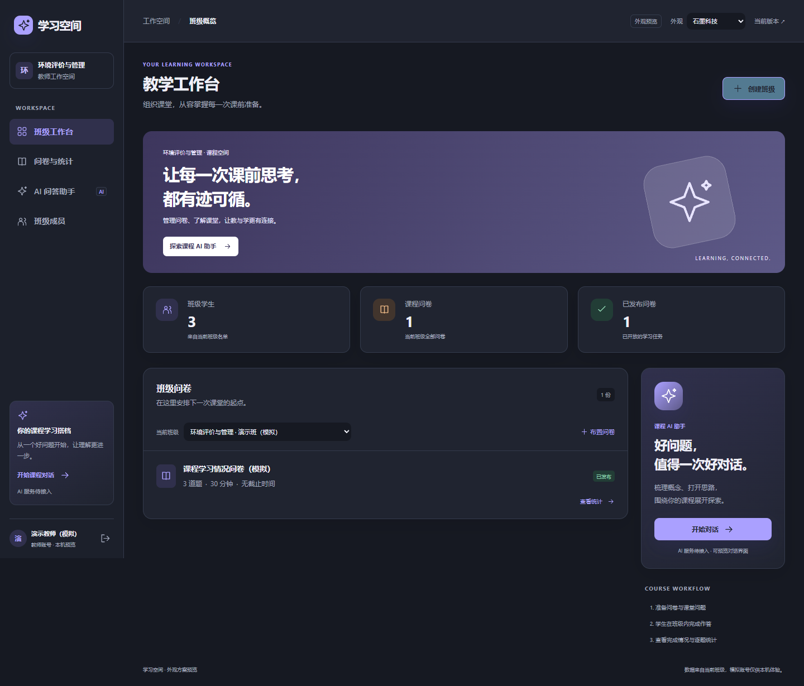
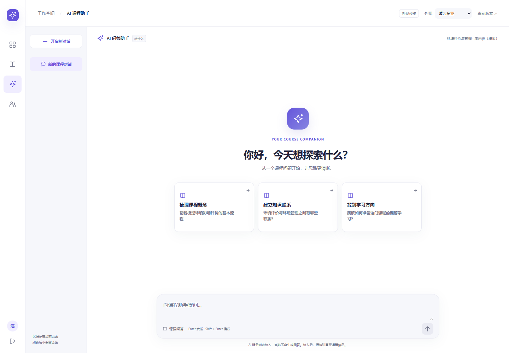
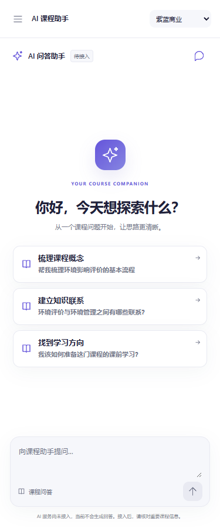

# 2026-10-28：商业工作台与 AI 对话界面独立预览

## 本轮需求与交付状态

用户认可已有基本框架，要求先查找现成产品、提供截图挑选，再试做一版更商业化的工作台；同时改善 AI 助手入口与问答界面，采用主流 AI 产品常见的对话布局。

本轮已完成独立界面预览、截图与验证。代码分支为 `design/commercial-preview`，界面实现提交为 `de723144116a5dde7c3a975113b6414fb1f4f0ec`，对应[草稿 PR #5](https://github.com/zlingting123-svg/preclass-learning-evaluation/pull/5)。本次另将总结和截图归档到本目录。**用户尚未确定最终外观，主页面未被替换，未合并 main，也未对外部署。**

## 完成的修改

### 1. 商业化工作台与三种外观

- 新增侧栏工作空间导航、顶部上下文、课程横幅、班级指标、问卷列表和专属 AI 入口卡片。
- 班级人数、问卷数、发布数读取现有权限接口，不编造趋势或教学效果。
- 支持右上角切换：**A 紫蓝商业、B 深绿专业、C 石墨科技**；本轮默认试版为 A。
- 使用统一颜色、字体和组件样式，补充悬停、键盘焦点、按下、禁用、加载、错误和成功反馈。

### 2. AI 助手入口与对话界面

- 原文字链接式入口改为导航入口及助手专属卡片。
- 对话布局改为窄导航、会话列表、中心欢迎区、建议问题、消息区与底部输入框。
- 支持点击建议问题填入、Enter 发送、Shift + Enter 换行、新建及切换会话、复制消息、失败重试、停止发送。
- 失败重试不重复追加同一提问；取消后不追加迟到的回复。
- 手机端收起侧栏，可打开导航抽屉和会话列表，输入框与发送按钮保持可用。
- AI 尚未接入：真实请求继续显示 `AI_NOT_CONNECTED`，不会生成虚构回答。会话仅保存在当前页面模块内存，刷新或离开模块后不保留。

### 3. 与现有业务集成的边界

- 新入口为 `frontend/design-preview.html`，新增组件和样式在 `frontend/src/preview/`。
- 通过现有登录、角色、班级权限接口读取数据，在预览的内存路由中复用已有名单、问卷编辑、作答和统计组件。
- 原 `frontend/src/App.tsx`、`frontend/src/pages/Core.tsx`、后台、共享契约和主业务路由没有因本轮设计改版而修改。
- Vite 生产构建仍以原 `index.html` 为入口；预览入口尚未加入生产构建。不能把“主入口构建通过”解释为“新外观已发布”。

## 截图

以下均为本项目实际浏览器截图，使用明确标注的本机模拟班级。截图没有包含账号口令、令牌或真实学生信息。

### A：紫蓝商业工作台



### B：深绿专业工作台



### C：石墨科技工作台



### AI 对话桌面版



### AI 对话手机版（375px）



## 参考来源

- [Disco 官方公开产品页](https://www.disco.co/)：参考商业学习平台的品牌层次与产品结构。
- [Chatbase 官方公开产品页](https://www.chatbase.co/)：参考专业字重、空间节奏和品牌色。
- DeepSeek 当时重定向至登录页，未获取其登录后的对话截图；Qwen 返回了欢迎文字，但截图仍有加载占位，两者未被当成完整聊天参考交付。

外部参考截图留在本次聊天本地交付中；GitHub 本目录归档的是本项目自身预览截图，没有把第三方商标、图片或源码作为产品资产。

## 实际验证

| 验证类型 | 已执行结果 | 证据与限制 |
|---|---|---|
| 前端静态检查 | `npm --prefix frontend run check` 通过 | 包括新增预览 TypeScript |
| 主入口生产构建 | `npm --prefix frontend run build` 通过 | 仍是原业务入口，未发布预览外观 |
| 预览真实 HTTP | 登录、读取班级/问卷、未接入错误、重试不重复消息、会话切换通过 | [真实 HTTP 预览记录](2026-10-28-界面预览/真实HTTP预览验证.json)；数据为模拟班级 |
| 响应式检查 | 320 / 375 / 414 / 768px 的工作台与对话无整页横向溢出，移动导航和发送按钮可用 | 浏览器宽度检查，不是真实手机验证 |
| 对话 UI 模拟 | 换行、发送、成功消息、复制、取消后不追加回复、会话隔离通过 | [UI 模拟交互记录](2026-10-28-界面预览/UI模拟交互验证.json)；明确不代表真实 AI 接入 |
| 浏览器异常 | 本轮预览检查 `pageErrors` 为空 | 未据此推断生产性能或并发能力 |

原核心业务的后台 35 项、HTTP 8 项等属于上一轮基线验证，不重复计入本轮界面检查。详情可查[预览验证说明](../frontend/verification/2026-10-28-ui-preview.md)。

## 本机查看方式

在项目既有前后端服务运行时，打开：

```text
http://127.0.0.1:5173/design-preview.html
```

沿用本机模拟账号登录，右上角可切换三种外观。当前版本对照入口为 `http://127.0.0.1:5173/`。这些是本机地址，GitHub 下载源码后仍需按[本地启动说明](../integration/LOCAL_RUN.md)运行依赖与服务；GitHub 上传不会自动生成在线教学网址。账号口令和预览数据库没有随日志上传。

## 待办

1. 用户选择 A/B/C 或提出组合调整，再决定是否接入原主页面。
2. AI 同学按[既有接口交接说明](../docs/integration/AI接口交接.md)接入真实服务，并验证真实超时、错误和取消行为。
3. 需要正式发布时再处理构建入口、真实设备、部署和验收；目前未云部署、未做真机或 300 人压测。
