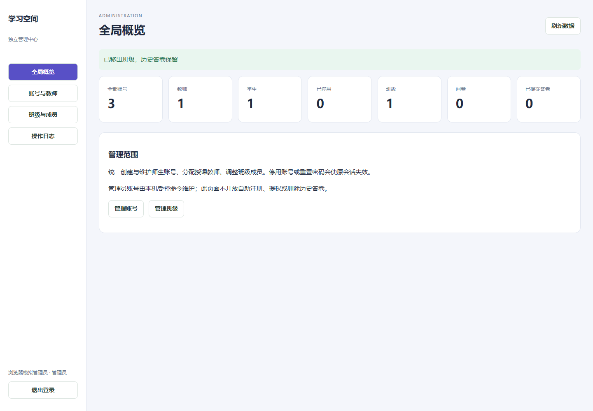
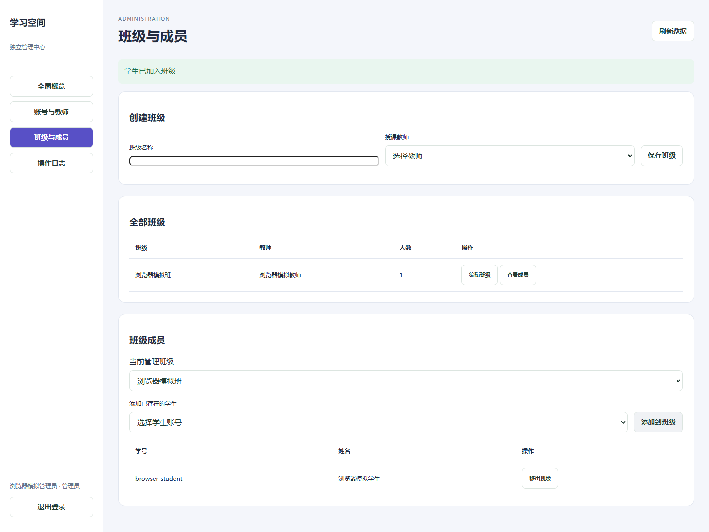

# 2026-10-29：独立管理员端与验证

## 当前范围

用户明确选择“独立管理员：账号、教师、班级及全局管理”。曾尝试同Wi-Fi静态二维码，但用户反馈微信扫码无法打开，随后明确要求“先不做这个，等买了服务器再调试，先进行其他部分”。因此本轮以管理员端为交付目标，**二维码/手机访问调试暂停**。

二维码图片、SVG及打印页只保留在本地归档。二维码曾通过解码校验、本机通过局域网地址能访问，但不能据此说手机已可用。临时外网卡监听已关闭，前端恢复127.0.0.1；未关闭防火墙、未采购服务器、未创建公网地址。后续有服务器和域名后再生成正式二维码。

## 已完成

- 独立管理中心：全局概览、账号与教师、班级与成员、操作日志。原登录入口和商业预览入口均可识别管理员。
- 全局账号/教师/学生/停用/班级/问卷/已提交答卷数量来自实际接口。
- 创建师生账号，按账号/姓名搜索、角色筛选、分页，维护姓名与启停状态。
- 重置密码、停用时撤销旧会话；恢复后旧令牌仍失效。保护管理员账号，网页不开放提权、自停或公开管理员注册。
- 管理员创建班级、改名、调整教师；批次资格必须明确授权，不能静默扩大权限。
- 添加/移出班级成员，保留账号与历史答卷；查看操作人、对象名称及动作日志。
- 创建新班后自动定位该班，刷新和切班时只应用当前班级的成员响应，避免旧请求覆盖新列表。
- 版本冲突检查、事务回滚、日志与业务写入一致；接口不返回口令/哈希/令牌。
- 补兼容性ID生成函数，为不支持randomUUID的浏览器保留Web Crypto回退；不表示手机链路已经验收。

接口见[管理员接口交接](../docs/integration/管理员接口交接.md)。源码：backend/src/admin.ts、frontend/src/pages/AdminPage.tsx；权限和会话变更位于auth.ts。

## 验证

- backend check/build、40项测试通过（原35项及新增5项）；新增覆盖权限/伪造角色、账号保护、停用恢复、重置撤销、班级归属、批次授权、成员、事务回滚和HTTP来源检查。
- backend启动/备份smoke通过。
- frontend check/build通过，生产限制3项沿用本轮已执行结果；未将旧历史JSON改写为本轮通过。
- 独立管理员浏览器5项通过：原登录分流、创建/搜索、停用/恢复/重置、班级/成员/日志、移动宽度与商业预览分流。使用真实隔离Express/SQLite和模拟用户，前端API路由至测试后台，无真实账号数据。
- 已目视桌面和375px截图。320/375/768宽度无整页溢出，表格在容器内横向滚动。浏览器pageErrors为空。
- 测试脚本integration/test/admin-browser.mjs已接入CI，若5173无服务会自行启动并在结束后关闭Vite；远端结论需按PR最新提交核查，不能由本地通过推断。

验证JSON见[管理员浏览器记录](2026-10-29-管理端/浏览器验证.json)。截图均为模拟用户，不包含账号口令或真实学生资料。

## 使用与后续

- 本机访问 http://127.0.0.1:5173/login，使用本机受控创建的管理员登录，即进入/admin；商业预览入口也支持管理员分流。
- 本轮本地模拟管理员账号名为demo_admin，随机口令只在本地“管理员账号-仅本机.txt”，未上传仓库。不是可用于公开生产的默认账号。
- 后续部署需要真实HTTPS、认证/存储适配、备份与运维验证；真实AI接入仍由负责同学完成。未上线、未做真机或300人压测。
- 以feature/admin-console提交PR，不自动合并main。保留同事独立学生会话分支，后续合并需核对认证与入口改动。
