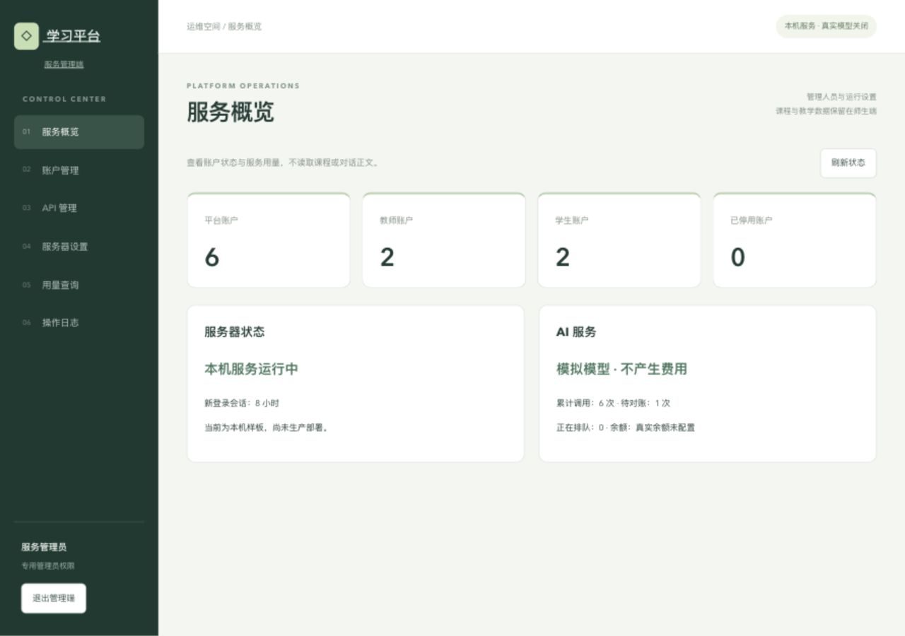
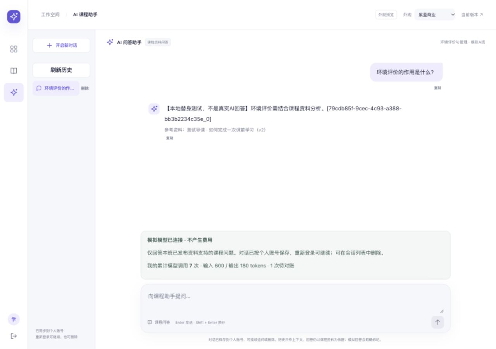
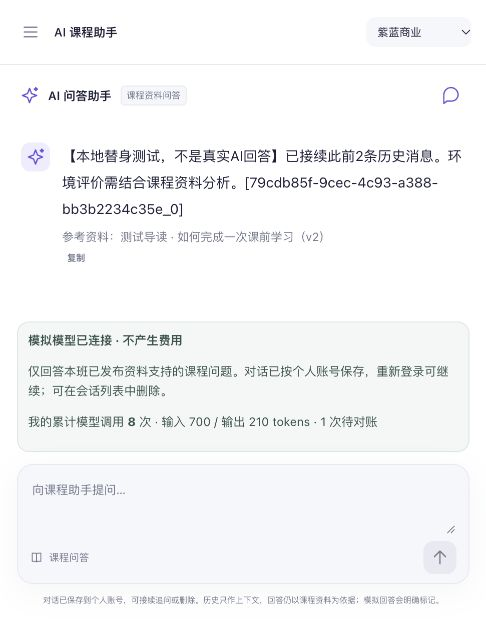
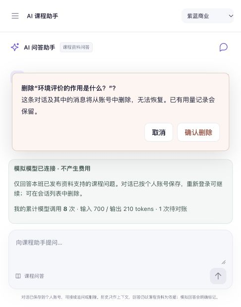

# 2026-10-29：AI模块、服务管理端与学生会话同步

## 本次上传范围

本次从同事已上传的`design/commercial-preview@61751cc`接续，将此前本机完成、尚未同步的三个批次一并上传独立分支`feature/student-conversations`，保留原问卷框架、商业预览和三种外观。主分支不直接修改，不对外部署。

1. **AI接入**：复用现有登录/班级权限，接入学生流式问答、资料来源、拒答、个人用量及教师粗粒度主题统计；独立AI源码在ai-module，主系统适配在backend/src/ai.ts。
2. **服务管理端**：专用管理员登录、全站人员账号查询与恢复、创建师生/停用/改密/撤销旧登录、服务器维护与会话设置、API模拟配额及部署池/环境变量名绑定、用量与操作日志。课程内容、问卷详情和班级教学导出仍在师生端。
3. **学生会话**：新建、切换、删除确认、服务端保存、跨次登录恢复、恢复上次课程/会话、近期上下文续问。用户新要求明确覆盖此前不留存正文的限制；会话正文只通过本人课程权限接口提供，教师与管理元数据不含正文。删除不删除计费记录，迟到回调不能重建会话。

## 对应说明

- [AI网页接入](../docs/integration/2026-10-28-AI接入.md)
- [服务管理端](../docs/integration/2026-10-28-服务管理端.md)
- [学生会话接口、存储及验证](../docs/integration/2026-10-29-学生对话保存与续聊.md)
- [持续接续记录](../handoff/CODEX_CONTINUE.md)

## 验证与证据

上传前检查：后台check/build与62项测试，前端check/build与3项生产限制，AI模块check与18项测试。此前也实际运行后台smoke与管理设置的进程重启恢复。

学生浏览器实际验证了新建问答、刷新重登恢复原课程/会话、带上下文追问；删除确认在页面检查后取消，实际删除/生成中删除/防迟到写回由隔离HTTP测试验证。管理端登录、按姓名找回账号、保存/重读API设置、服务器设置和操作日志已验证。测试结果不冒充真实模型或上线验收。

- [后台测试](../integration/verification/2026-10-29-upload-backend-tests.txt)
- [AI模块测试](../integration/verification/2026-10-29-upload-ai-tests.txt)
- [服务管理端验证](../integration/verification/2026-10-28-admin-browser.json)
- [管理设置重启恢复](../integration/verification/2026-10-28-admin-runtime.json)

### 页面截图（模拟账号与课程）

## 运行与边界

本机命令：`SAMPLE_BACKEND_PORT=3002 SAMPLE_FRONTEND_PORT=5174 python3 integration/sample.py start`；主页面5174、商业预览`/design-preview.html`、管理端`/admin/login`，后台3002。停止同脚本stop，保留数据。依赖按ai-module、backend、frontend各自lockfile安装并依次构建。

账号/管理员随机口令、API密钥、数据库、实际对话与运行文件只在本机work，不随源码上传。真实DeepSeek/余额通知未启用；当前为mock，未产生API费用。当前词项检索和有限指代追问不是通用语义RAG。未完成真实设备、整站300/500并发、云和多副本验收。

## 同步状态

已上传`feature/student-conversations`，创建[草稿PR #6](https://github.com/zlingting123-svg/preclass-learning-evaluation/pull/6)，目标为`design/commercial-preview`。远端已核验功能提交`7ac9d1bef2150253917f69efc7d74b8a59bfe612`，包含`b48b080`（AI接入）、`5984bc6`（服务管理端）与`7ac9d1b`（会话和本轮日志）。本次随后补交同步结果文档；最终分支提交以PR头为准。未合并main，未部署，真实调用关闭。远端CI尚未确认通过，不以本机结果代替远端结果。
