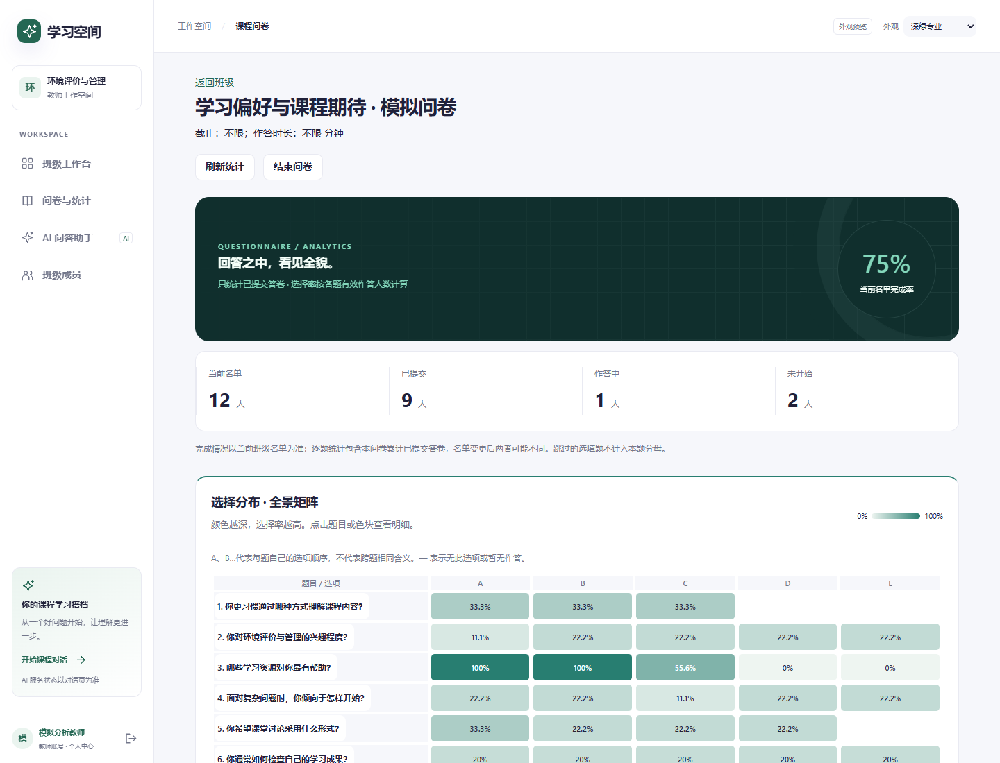
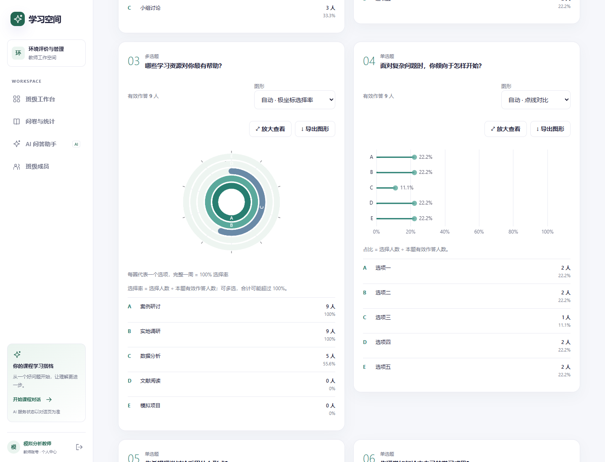

# 产品版本 0.3：发布更新记录

核对日期：2026-10-29（Asia/Shanghai）。产品版本由用户指定为 **0.3**；共享接口契约仍为 **0.5.0**，npm包历史版本及旧v01–v04归档不是本次产品版本号。当前React/Node工作区是维护入口，Moodle和旧评分界面仅作历史参考。

## 已完成

| 项目 | 结果 | 验收范围 |
| --- | --- | --- |
| 管理员集中名单与多教师班级 | 按学号姓名受控建号/分班，允许同班多位教师，首次改密与角色/班级授权由后台执行 | 原功能已整合，本轮后台全量回归覆盖 |
| 统一学习空间登录 | 三角色共用账号登录，按真实角色分流；移除返回废弃界面入口 | 本地真实HTTP及原服务器浏览器记录 |
| DeepSeek真实接入 | 余额/预算门禁、流式回答、取消和未知用量保护；8192输出上限/180秒超时配置支持 | 已有真实提供商小样例；本轮只做替身网络回归，不追加付费调用 |
| 用途路由与Key管理 | 管理端加密保存Key、不回显；学生/教师问答按用途路由，教师私人对话与学生隔离 | 后台与AI模块测试覆盖；主密钥/真实Key不入Git |
| 问答体验 | 多轮上下文、语义判断课程范围、无关请求简短回复、Markdown/LaTeX、班级成员切换 | 原真实模型小样例+隔离HTTP浏览器；不是语义准确率或教学有效性证明 |
| 账号删除 | 管理端预览、二次确认、版本/权限/关联检查与事务删除；保留历史业务记录 | 后台回归与原隔离浏览器验证；不代用户批量删除真实账号 |
| 个人中心 | 三角色修改自己的头像/私有昵称/密码，真实姓名与学号只读，教师管理名单仍用真实身份 | 后台及原隔离浏览器；改密撤销旧会话 |
| 问卷统计数据舱 | 整卷热力矩阵、极坐标/树图/环形/分布条/点线/柱状自动选择与切换、放大及PNG导出 | 12题模拟问卷，完整人数与比例，多选/选填/零回答口径，4种手机宽度 |
| 私有服务器调试部署 | current已指向20261029-survey-analytics，应用和网关active；health契约0.5.0 | 重新读取实际服务器与健康接口，productionReady=false |

## 本轮重新执行的检查

- 后台全量测试：94/94通过；AI模块全量测试：20/20通过。
- 统计组件实际HTTP+内存SQLite+Chrome：12题全部保留，多选9人分母，选择率100%/100%/55.6%，跳过选填题不计分母，零回答显示空状态。
- 7种图形切换、热力矩阵定位、放大/Escape和PNG下载通过；320/375/414/768像素无整页横向溢出。
- 服务器实际静态构建另测同一交互流程，全部API请求被转到隔离内存后台，没有对真实账号或答卷写入测试数据。
- 服务器已部署前端JS/CSS/HTML逐项HTTP获取并通过SHA256核对；本轮发布无数据库迁移、无后台重启。
- AI/后台/前端三模块构建通过，生产构建限制3项、统一学习空间入口6项和管理端浏览器5项通过。核心旧路由回归首次被既有SSH隧道占用5173端口阻断，保留隧道、增加可配置测试端口，并更新旧标题/人数明细定位后在5191重跑8项通过；没有取消人数及图形断言。远端CI以新提交实际结果为准。

## 未完成或尚未验收

1. 正式公网域名、备案/HTTPS、跨真实设备外网访问。现有服务器是SSH隧道私有调试，不是可直接发给学生的公网教学网址。
2. 正式课程检索校准与真实资料样本评估；当前retrievalCalibrated=false，不把私有开发豁免写成正式生产就绪。
3. 问卷AI生成、教师AI统计评价和系统AI管理仍为预留功能，需要单独确认交付范围；聊天可用不代表三处均已实现。
4. 实际Android/MagicOS/iOS真机与校园网络验收；浏览器宽度模拟只证明布局。
5. 真实整站300人集中提交、500人课程规模与真实提供商限流/成本验收。AI测试中的300/500为模拟上游或连接结构，不等于整站容量。
6. 生产完整备份计划、受控异机副本与恢复演练；既有单库备份和模拟恢复不能代替整套生产验证。
7. 真实复杂PDF/Office、OCR/搜索及课程资料可用性按实际文件单独验收，不从解析样例外推。
8. 本次0.3没有重新制作或发布Ubuntu安装器；旧installer-v04及其源码哈希继续指向旧版本，不应冒充包含本次更新。

## 交付与下一步

代码与当前任务书经release/v0.3任务分支交付，基于最新整合分支，不合并main、不改写同事分支或旧版本快照。GitHub上的Actions最终状态以该提交实际运行结果为准。

下一阶段先收集用户对统计看板/个人中心的实际反馈，然后按明确授权推进公网与资料校准；不能按旧任务书重建Moodle、恢复旧登录或先行发明正式评分体系。

## 新版界面（模拟问卷）

