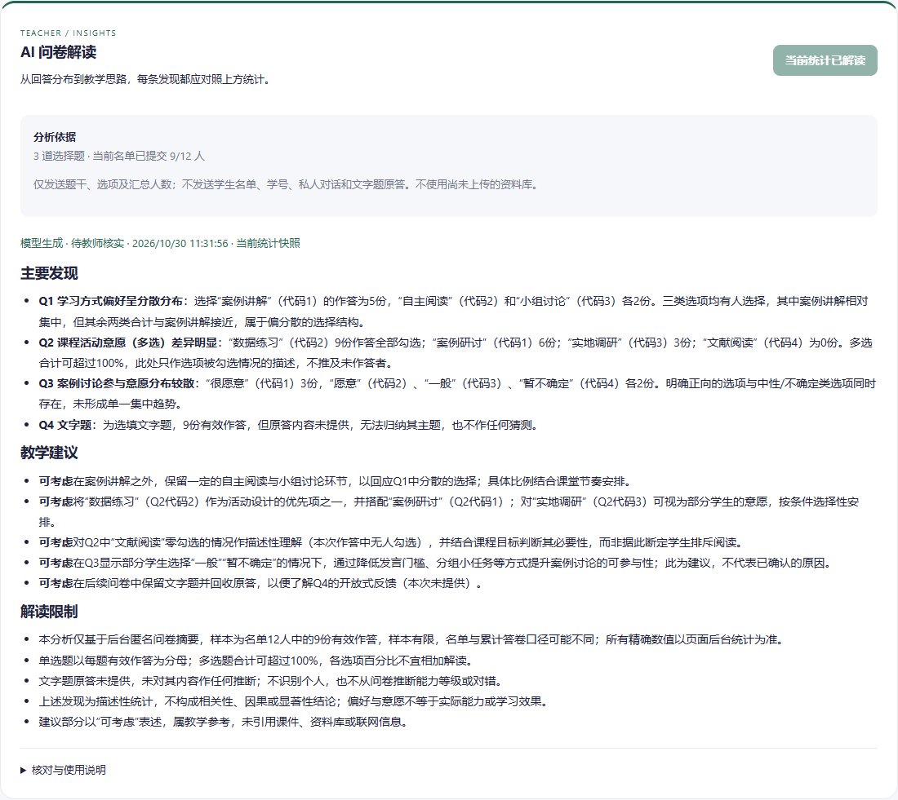

# AI问卷解读：本地实现交付（2026-10-30）

产品版本仍0.3；共享接口保留0.5.0，本次新增独立survey-insights类型。用户先要求修改本地网页并运行，随后要求上传GitHub。本轮功能未部署到正式网站，也未合并main。

## 功能

教师在统计页查看分析依据并点击生成。服务端重新读取授权问卷的已提交答卷统计，构造匿名摘要；不接受浏览器上传统计内容，不发送学生名单、学号、私人对话、问卷标题或文字题原答。题干和选项仍为教师输入，若包含个人信息需先清理。

复用现有Gateway/Scheduler/Ledger、Key存储、余额和费用门禁，使用teacher_analytics用途与专用系统提示。没有配置该用途会明确失败，不悄悄使用其他用途绕过配置。浏览器聊天请求不能指定该用途。

结果为主要发现、教学建议和解读限制，页面标明待教师核实。人数和比例由后台计算；模型结论不能代替统计事实或正式评分。文字题只发送题型/题号/有效作答人数与原答省略标记，本轮不分析开放式原答主题。资料库仍未上传，不假称依据课程资料。

GET /api/v1/core/surveys/:id/insights读取统计快照和报告；POST /api/v1/core/ai/insights仅接受classId/surveyId/expectedSnapshot。重复读取或生成同快照复用成功结果，当前进程拒绝同快照并发调用；统计更新则报告失效。结束前再次检查会话/班级权限和统计快照。失败/费用未知不自动重试，不承诺崩溃窗口或多实例下绝对只扣一次。

报告持久化在主应用Store的survey_insight记录，计费账本仅存元数据；本地试用使用隔离内存数据库，重启会清空试用数据。

## 已执行验证

- 三模块构建通过，保留已有前端包体积提醒。
- 后台95/95、AI模块20/20通过；新增测试覆盖匿名汇总、多选分母、零回答、权限、过期快照、同快照并发拒绝、成功缓存、统计更新、用途缺失与账本用途。
- 本地前端+独立回环测试后台使用模拟问卷，实际DeepSeek完成一次解读；后续网页验证读取缓存，没有额外生成。真实Key始终留在服务器，正式配置只读，未写真实业务记录。
- 浏览器无pageerror；320/375/414/768无整页溢出；刷新后重新登录读取保存结果。原认证仅保存内存会话，未修改为持久化令牌。
- 新增可移植浏览器测试，使用明确模拟上游在CI验证生成、用途/结算、刷新复用、图表回归与手机布局；真实提供商样例与CI模拟验证分开记录。

## 集成边界与下一步

本功能从release/v0.3@e38e995独立分支交付，仅包含当前模块所需变更。PR #11的上游整合分支已经前进并显示冲突，不在本次上传中强推或改写它。正式服务器已被另一轮工作更新至20261030-reference-ai-v3；上线前先对齐同事的新代码、资料库适配和接口，不能拿当前旧基线覆盖服务器。

已完成的是本地选择题汇总分析和真实样例验证；正式集成/上线仍待对齐。既定顺序不变：AI问卷解读→等待用户上传资料库后接入/校准→域名/HTTPS与整站压力测试→固定二维码和域名直达登录。AI生成问卷仍预留，未自动扩展范围。

仓库不包含试用账号文件、真实Key、主密钥、数据库、SSH隧道/启动凭据或临时服务脚本。新对话先核对当前分支/PR和正式服务器版本，再继续用户反馈。

## 模拟问卷的真实DeepSeek结果预览

